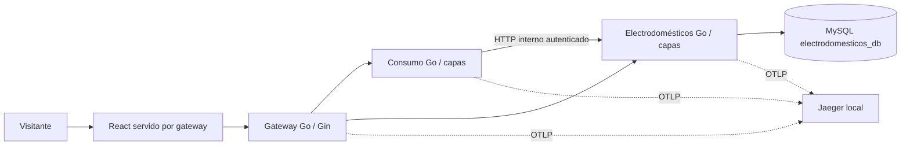

# Arquitectura - Entrega 2

Versión 2.0.0 · Estado implementado localmente. El dominio fue aprobado por la cátedra. Las vistas de entrega 1 se conservan como antecedentes del sistema final y no describen todos los componentes ya operativos.

## Contenedores actuales

Gateway publica 8080 y Jaeger 16686 en loopback. Los servicios de negocio y MySQL quedan en una red de Compose sin puertos publicados. React se compila en el build y se sirve desde el gateway; no hay un servidor Node en ejecución. Jaeger usa almacenamiento en memoria y pierde sus trazas al reiniciar; las evidencias seleccionadas se exportan a archivos.

## Responsabilidades y propiedad

| Componente | Implementación de este hito | Datos propios |
|---|---|---|
| Gateway | Lista explícita de rutas, proxy, correlación, límite por origen/cliente, interfaz y contratos | Contadores temporales; sin entidades de negocio |
| Consumo | Cálculo decimal, validación, capacidad M2M y simulación por catálogo | Ninguna persistencia para simulaciones |
| Electrodomésticos | Catálogo activo, búsqueda SQL, filtros, orden, paginación y resolución interna por lote | Tabla electrodomesticos, fichas versionadas y semillas en MySQL |
| Usuarios | Esqueleto de entrega 1, fuera del arranque de entrega 2 | Sin BD implementada |
| Solar | Esqueleto de entrega 1, fuera del arranque de entrega 2 | Sin BD implementada |

Consumo no recibe credenciales MySQL ni conoce tablas de Electrodomésticos. Solo usa su API HTTP interna de resolución. La clave M2M no aparece en React. El gateway nunca publica `/internal/v1/electrodomesticos/resolver`; el servicio exige un secreto interno independiente.

## Capas y dependencias

Consumo: `HTTP → application → integración HTTP` cuando se usan fichas. El cálculo puro permanece en application, sin Gin ni SQL. Electrodomésticos: `HTTP → repositorio de consultas`; su flujo de lectura no añade un servicio de aplicación sin reglas propias. La persistencia y sus consultas se encapsulan en repository. La validación de transporte permanece en HTTP. `platform` solo contiene infraestructura técnica: trazas, logs, servidor, salud y limitador; no comparte entidades del dominio ni repositorios.

Se usa `database/sql` con el driver MySQL para consultas y transacciones explícitas. GORM era una biblioteca prevista; no es necesario para este flujo de lectura y su cambio queda documentado en ADR-003-E2. Solar mantiene el diseño hexagonal para la final; no se presenta su esqueleto como un segundo estilo ya implementado.

## Flujo operativo

1. La interfaz carga las fichas activas desde MySQL pasando por el gateway.
2. El visitante elige ids de catálogo y declara cantidad/hábitos. El borrador vive únicamente en memoria React.
3. `POST /api/v1/publico/consumo-catalogo` entra al gateway y llega a Consumo con contexto W3C y correlación.
4. Consumo pide un lote de hasta 100 fichas activas al servicio Electrodomésticos. Este consulta MySQL en un span específico. Una ficha inactiva o inexistente invalida la entrada; no se confía en potencias enviadas por el navegador.
5. Consumo combina fichas y hábitos, valida todas las reglas y calcula con `big.Rat`. Redondea cada salida a seis decimales, mitad hacia arriba, sin redondeos intermedios para el total.
6. La interfaz muestra desglose, total y promedio, con traceId. Editar invalida el resultado visible; recargar elimina el borrador. No se escriben configuraciones, evaluaciones, outbox ni eventos.

La API M2M acepta potencias externas según el contrato 1.0.1 y usa el mismo cálculo. No depende del catálogo ni de MySQL: una caída de la base afecta el flujo por fichas, pero la estimación externa sigue disponible. `POST /api/v1/publico/consumo` conserva el cálculo anónimo con parámetros completos.

## Almacenamiento

MySQL 8.4 con volumen nombrado. El arranque crea la tabla si falta y ejecuta semillas por clave primaria mediante INSERT IGNORE dentro de una transacción. Reiniciar no duplica ni sobrescribe fichas existentes. La búsqueda usa consultas parametrizadas, solo activos, paginación acotada y un orden estable con id como desempate. Count y página se leen en una transacción de solo lectura con snapshot repetible.

El filtro textual usa LIKE literal con escape de comodines; no se declara como búsqueda full text ni como Meilisearch. Los índices B-tree ayudan con activos/nombre/categoría; un LIKE con comodín inicial puede recorrer candidatos. D6 documenta el índice dedicado previsto para la final. En este hito no hay caché: cada lectura consulta MySQL.

## Resiliencia, seguridad y observabilidad

Gateway: presupuesto de 8 s; Consumo → catálogo: timeout total de 2 s, conexión de 500 ms. Circuit breaker en Consumo abre tras tres fallos, bloquea llamadas 10 s y permite una prueba de recuperación. No hay reintentos automáticos ni datos de éxito inventados. Un fallo devuelve 503; el usuario puede reintentar. El cálculo externo sigue aislado de esta dependencia.

Los healthchecks exigen `Authorization: Bearer HEALTHCHECK_TOKEN`; liveness confirma proceso y readiness verifica las dependencias indispensables de cada componente. Consumo declara readiness para el cálculo stateless; el catálogo comprueba MySQL. Gateway exige disponibilidad de Consumo y catálogo para el flujo de interfaz. La indisponibilidad de Jaeger no impide el negocio.

Logs JSON con servicio, ruta normalizada, método, estado, duración, request_id, trace_id y span_id. Sin cuerpos, valores de consumo, credenciales ni SQL. OpenTelemetry transmite spans por OTLP/HTTP a Jaeger. La API devuelve su traceId. Muestreo 100% local para la demostración; ajustar antes de un uso continuo.

Rate limit inicial: token bucket de 1 solicitud/s y ráfaga 10; 429 con Retry-After. Gateway limita por IP observada y por hash de clave M2M; no confía en X-Forwarded-For del cliente. Consumo aplica un segundo límite conservador, y ve al gateway como origen único para visitantes. Esta restricción agregada es una limitación conocida para varios usuarios simultáneos. Los contadores tienen memoria acotada y no se comparten entre réplicas.

## Evolución y deuda técnica aceptada

- Identidad, permisos de propietario y administración quedan para la final; sus rutas privadas no son funcionales. Anónimos reciben 401 y no hay altas de catálogo públicas.
- Pendientes: persistencia de Consumo, MySQL de Usuarios, MongoDB de Solar, eventos/outbox, indexación Meilisearch, caché Valkey, JWT y balanceo activo. Las dos réplicas Solar previstas compartirán la misma BD de Solar.
- El proveedor y consumidor fueron asignados; todavía no hay contrato recibido. D9 es provisional. No hay adaptador externo ficticio ni pruebas que pretendan validar ese contrato desconocido.
- Jaeger y MySQL son instancias únicas, sin alta disponibilidad ni copia automática. `.env` es un archivo local ignorado, no un gestor productivo de secretos. Las imágenes usan tags versionados, todavía sin digests fijados.
- La tabla se inicializa idempotentemente; no hay aún un ejecutor de migraciones incrementales para cambios de esquema posteriores.
- El tablero de métricas, alertas, pruebas de capacidad completas y fallo entre réplicas corresponden a los siguientes hitos. D13 solo extrae conclusiones del ensayo registrado.
- La interfaz de entrega 2 cubre consumo temporal. No contiene botones de guardado/login/solar que aparenten estar implementados.

Ver [ADR](adr/README.md), [evidencias](DELIVERY-2.md) y [antecedente de entrega 1](ARCHITECTURE-ENTREGA-1.md).
