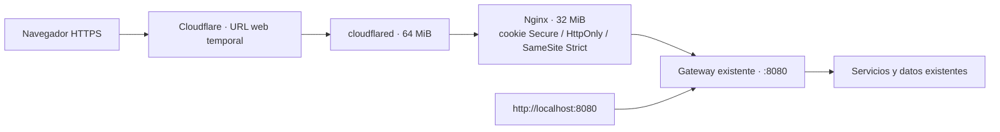

# Publicación HTTPS de la página local

Fecha: 2026-11-11. **Publicada y verificada:** [https://boring-eclipse-copying-did.trycloudflare.com](https://boring-eclipse-copying-did.trycloudflare.com). El usuario autorizó explícitamente publicar la web completa, incluido el tránsito de login, sesiones y datos por Cloudflare. Se verificaron portada y cotización real por HTTPS después de restaurar el proveedor. La aplicación local y esta web dependen de la PC/Docker; la API de Clínica en Render es independiente. El túnel M2M local antiguo permanece detenido. [Evidencia actual](evidence/proveedor-real-2026-11-11/https-web.json).

Usar las mismas cuentas que en localhost o crear una nueva. Se requiere iniciar sesión de nuevo por tratarse de otro hostname. El enlace es público; las capacidades privadas exigen autenticación y permisos.

## Funcionamiento

La entrada reutiliza el gateway y todos los servicios/bases que ya funcionan localmente. No modifica código de aplicación, contratos, claves ni volúmenes. La web y su API se sirven bajo el mismo hostname, de modo que las rutas relativas del frontend no requieren cambios ni CORS adicional.



[compose.web-publica.yaml](../compose.web-publica.yaml) define un proyecto independiente, renewable-web-publica. El túnel solo pertenece a su red web; Nginx también conecta con la red del gateway existente. No publica puertos adicionales en Windows ni monta credenciales, bases o Docker socket. Usa imágenes fijadas por digest, usuario Nginx sin privilegios, raíz de solo lectura, tmpfs acotado y límites de CPU/memoria.

[infra/web-publica.conf](../infra/web-publica.conf) conserva Host/Origin para la validación de sesión, marca renewable_refresh como Secure solo en esta entrada y bloquea /health, /metrics, /internal y rutas de archivos ocultos. Se conservan autenticación, roles, propiedad y límites del gateway. No se confía en cabeceras de IP reenviadas: el tráfico público invitado comparte el límite del origen proxy; los privados conservan el límite por cuenta. No se presenta como configuración de alta concurrencia o producción.

Las mismas cuentas y datos están disponibles desde ambos accesos. Las cookies pertenecen a hostnames diferentes: habrá que iniciar sesión en el nuevo enlace aunque la sesión local siga abierta. HTTPS termina en Cloudflare, que intermedia solicitudes y respuestas, incluidas credenciales de login y datos de cuentas; el usuario autorizó expresamente ese alcance. El enlace público permite usar la calculadora y crear cuentas; las capacidades privadas seguirán exigiendo autenticación y permisos.

## Operación

Desde la carpeta del repositorio:

```powershell
.\scripts\publicar-web.ps1 iniciar
.\scripts\publicar-web.ps1 estado
.\scripts\publicar-web.ps1 detener
```

Iniciar comprueba que el gateway local ya esté saludable, levanta solo los dos contenedores web y obtiene la URL de los registros de la ejecución actual del túnel. Estado guarda la URL observada en .runtime/web-url.json, excluido de Git. No presenta la URL de un túnel detenido como activa. Detener afecta únicamente la publicación web: mantiene el acceso local y el túnel M2M de Clínica. No se crean nuevos secretos ni se entrega ninguna credencial públicamente.

Antes de iniciar se necesita el sistema local: scripts/compose.ps1 up -d --no-build. Si todavía no se construyeron sus imágenes, seguir el procedimiento del README. Una red de Compose renombrada exige actualizar networks.aplicacion.name en el archivo web.

## Comprobaciones realizadas

[Sonda interna](evidence/publicacion-web-2026-11-09/local.json): sintaxis Nginx válida; HTML y JavaScript idénticos a los del gateway, cálculo invitado, búsqueda solar, alta/login/refresh/logout de cuenta sintética, rechazo de otro Origin, cookie Secure en la entrada y cookie local sin Secure, propiedad y datos compartidos. Se eliminó el lugar sintético; no se usaron datos privados reales. La sonda no inicia túneles y no prueba HTTPS público por sí misma.

Para repetir la verificación interna, iniciar solo web-edge, sin tunnel, y ejecutar:

```powershell
docker compose -f compose.web-publica.yaml up -d --no-deps --wait web-edge
.\scripts\compose.ps1 --profile verificar run --no-deps --rm verificar-real python -B tests/web_edge.py
docker compose -f compose.web-publica.yaml stop web-edge
```

La [sonda HTTPS](evidence/publicacion-web-2026-11-09/https.json) aprobó sobre el enlace real con certificados verificados: contenido idéntico, cálculo/búsqueda, registro, login, refresh, logout, cookies y protección de rutas/origen. Las [cuatro pruebas de navegador](evidence/publicacion-web-2026-11-09/e2e/resultados.json), en escritorio y móvil, aprobaron guardar, recargar sesión, calcular paneles, archivar/restaurar, eliminar consumos/lugares y filtrar paneles. No hubo fallos, omitidos ni flaky. Al repetir, establecer WEB_EDGE_URL y BASE_URL con el enlace de la ejecución actual; no desactivar verificación de certificados.

La [verificación de continuidad](evidence/publicacion-web-2026-11-09/continuidad.json) confirmó localhost 200, Clínica 200, contrato M2M congelado y el mismo inicio de su túnel. No se rotaron credenciales. La sonda local anterior se conserva como antecedente de preparación, no como estado actual de publicación.

## Continuidad y alternativas

Quick Tunnel funciona sin cuenta ni dominio, pero su hostname cambia al crear otro túnel y no ofrece garantía de disponibilidad. La PC, Docker, servicios y conexión deben permanecer activos. Para continuar con la PC apagada se necesita alojar la aplicación y sus dependencias en otro equipo/hosting. Un hostname estable requiere un túnel administrado con la configuración correspondiente. [Documentación oficial de Cloudflare](https://developers.cloudflare.com/tunnel/get-started/quick-tunnels/).

Se conserva Nginx como herramienta de proxy, compatible con el enfoque de intermediación de las clases; no reemplaza el gateway Go ni su balanceo de negocio. Se elige una entrada de configuración porque resuelve las cookies HTTPS sin alterar la aplicación o romper localhost. Las alternativas y motivos se añaden a los ADR existentes, sin crear un ADR sustituto. [Atributos de cookies en Nginx](https://nginx.org/en/docs/http/ngx_http_proxy_module.html#proxy_cookie_flags).


## Recursos observados

Los dos contenedores web sumaron 20.08 MiB en la [muestra posterior a las pruebas](evidence/publicacion-web-2026-11-09/recursos.json), con límites de 32 y 64 MiB. Los 22 contenedores del sistema más ambas publicaciones sumaron 1537.7 MiB. No había verificadores temporales activos ni otros contenedores. La suma Docker no incluye toda la memoria/caché de WSL y Windows; es una muestra puntual. No se cambió la configuración global de WSL.
